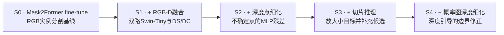
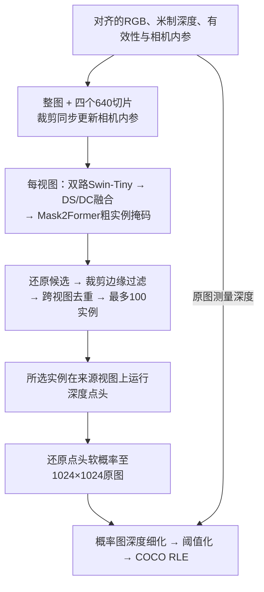
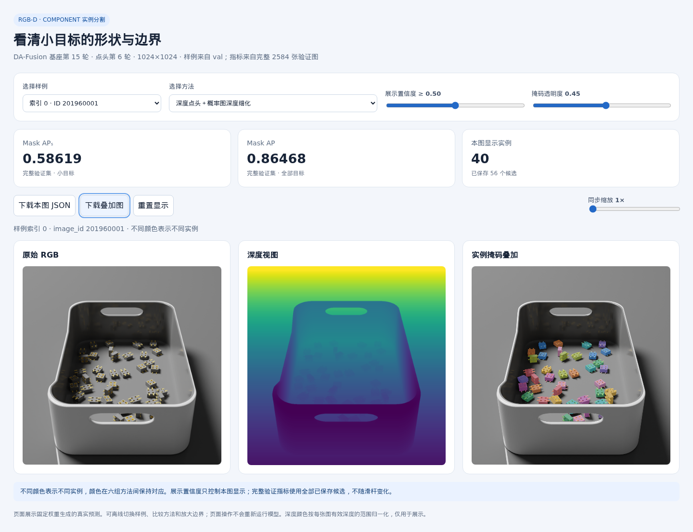

# DPSeg

**Depth-guided Point Refinement for Segmentation** · RGB-D 小目标实例分割与深度边界细化

课程 `component` 实例分割项目，包含 Mask R-CNN、Mask2Former、DA-Fusion 课程适配、深度点头和深度引导的掩码细化。提供训练与推理入口、完整验证结果、源码核验记录和离线交互 Demo。

## 任务与评价

任务是在合成渲染的电子元器件 RGB-D 图像中，分割单类 `component` 的每一个可见实例。图像与输出掩码尺寸均为1024×1024。

| 划分 | 图像数 | 用途 |
|---|---:|---|
| train | 14,432 | 基座微调与点头训练 |
| val | 2,584 | 选择模型、点头轮次和配置 |
| test | 2,112 | 生成课程竞赛提交 |

主指标是 **COCO Mask APₛ@[0.50:0.95]**，同时报告整体 Mask AP。IoU阈值从0.50到0.95、步长0.05；small按原图标注掩码面积 `[0, 32²]` 像素统计，每图最多100个预测实例。本文所有分数范围均为0–1。Kaggle公榜约使用30%的测试数据，不能直接与完整验证集或历史本地测试分数对应。

评价与提交格式详见[指标说明](docs/course_metric.md)。

## 技术路线

技术路线与下方S0–S4消融保持一致：**Mask2Former课程微调 → 加入RGB-D融合 → 加入深度点细化 → 加入切片推理 → 加入概率图深度细化。** 每一步保留已有组件，分别针对外观与几何互补、掩码细节、小目标漏检和边界跨深度扩散。



### 1. Mask2Former fine-tune（S0）：建立RGB基线

以公开COCO实例分割权重初始化Swin-Tiny骨干和Mask2Former解码器，将类别预测器改为课程的单前景类与无目标两类，在完整课程训练集上微调。像素解码器融合多尺度特征，查询解码器预测每个实例的类别与粗掩码；训练保留原生Hungarian集合匹配、分类损失、点采样BCE/Dice及辅助层监督。

主消融固定1024输入、15轮训练和第15轮权重。S0只使用RGB，作为后续融合方案的参照。实现见[RGB控制组](rgbd_seg/course_progressive_rgb.py)与[Mask2Former课程适配](rgbd_seg/course_finetune_mask2former.py)。

### 2. + RGB-D融合（S1）：引入几何特征

在Mask2Former上加入深度分支和四尺度融合，形成DA-Fusion课程适配：

- 根据各图的 `depth_scale_m` 将深度转换为米，利用相机内参反投影为XYZ，标准化后附加有效性通道；保持RGB与几何输入空间对齐。
- 两套参数独立的Swin-Tiny分别提取RGB外观与深度几何特征。
- 各尺度先通过DS（可变形自注意力）增强模态内特征，再通过DC（双向可变形交叉注意力）交换模态间信息，送入Mask2Former解码器。

S1不启用点头、切片或概率图后处理。它与S0对比的是包含额外编码器和融合模块的整个RGB-D方案。两者均从公开初始化分别训练，S1并非直接续训S0的课程权重。

课程适配采用双Swin-Tiny和XYZ表达，保留公开实现的四尺度DS/DC。与原论文的骨干、深度表达、训练配方及代码细节差异见[方法约定](docs/dafusion_method_contract.md)。

### 3. + 深度点细化（S2）：修正不确定位置

点头借鉴[PointRend](https://arxiv.org/abs/1912.08193)的自适应点预测思路。当前实现是接在DA-Fusion上的残差改造：

- **共同输入：** 最细融合骨干特征96维、像素解码器特征256维，以及该实例的粗掩码logit。
- **额外深度输入：** 中心有效性、四邻域有符号深度差，以及四组中心和邻居同时有效的标记，共9维。深度差使用 `tanh(差值 / 1mm)` 压缩。
- **预测结构：** 3个256维隐藏层的共享MLP，各层再次拼入粗掩码logit，输出残差logit。末层零初始化，使初始预测保持原基座结果。
- **训练采样：** 每实例784个点，75%偏向不确定位置、25%随机采样，以点BCE监督。普通点头和深度点头共享冻结特征、匹配、采样位置与监督。
- **推理细化：** 从256×256粗掩码到512，再到1024逐级细化；每级每实例最多重新预测784个点。

推理区域来自预测掩码，只使用RGB、测量深度、有效性和相机内参。点头保留类别、置信度、实例数量和顺序，细化为空时回退。因此，它主要改善已发现目标的形状，无法通过新增实例找回完全漏检的目标。

S2固定第15轮RGB-D基座，仅增加已训练的第6轮深度点头，仍使用整图推理，并关闭概率图深度细化。

Mask2Former自身已借鉴PointRend的训练点采样来计算掩码损失；本项目增加的是**训练并在推理时运行的残差点头**。实现见[点头源码](rgbd_seg/course_point_refinement.py)、[概率图细化](rgbd_seg/course_tiled_probability.py)与[方法说明](docs/methods.md)。

### 4. + 切片推理（S3）：补充小目标候选

保留整图视图，并增加四个640×640角部切片。相邻切片重叠256像素，各切片按既定流程放大到1024输入模型，使小目标以更大的相对尺度进入网络。

1. RGB、深度、有效性同步裁剪，并按裁剪偏移更新相机内参。
2. 将各视图候选掩码还原到原图坐标，过滤触及内部裁剪边缘的实例。
3. 按原始分数选择代表实例，对跨视图mask IoU大于0.5的重复候选去重，保留前100个实例。
4. 固定候选来源、分数和顺序，对所选实例在各自视图上应用同一个深度点头，将细化结果还原到原图坐标。

S3继续保留S2的深度点头，关闭概率图深度细化，不增加训练参数。相关实现见[切片推理](rgbd_seg/course_tiled_probability.py)与[五步消融切片对照](rgbd_seg/course_progressive_ablation.py)。

### 5. + 概率图深度细化（S4）：约束最终边界

将S3点头输出的软概率图还原至原图坐标，以空间距离和测量深度差共同决定邻域权重，执行一次加权平均，再以0.5阈值生成二值掩码。深度差大的邻居权重更低，用于减少跨几何边界的扩散。

固定邻域半径2像素、空间标准差1.5像素、深度标准差0.001米、迭代1次；无效深度、平票和细化为空时按既定规则回退。S3与S4的实例类别、置信度、数量和顺序完全相同，因此最后一步只比较掩码形状的变化。概率细化替代历史二值深度修正，不再叠加一遍二值平滑。实现见[概率图细化](rgbd_seg/course_tiled_probability.py)。

### 完整系统的实际执行顺序

上面的五步是**组件加入及消融比较的顺序**。加入切片后，它在输入端生成多个视图；代码并非先细化一次整图掩码，再将掩码裁成切片。完整S4的执行过程如下：



训练分两阶段：先微调基座，再冻结RGB-D基座训练点头。切片与概率图深度细化均为推理阶段操作，不参与基座或点头训练。

## 消融实验与结果

<!-- progressive-ablation:start -->
### 五步累计消融

以下各行累计保留上一行的组件。主表统一使用完整本地测试集2,112张图，分数范围为0–1。

| 编号 | 配置（累计添加） | 本地测试 AP | 本地测试 APₛ | APₛ 相对上一组增量 |
|---|---|---:|---:|---:|
| S0 | Mask2Former fine-tune | 0.705677 | 0.185779 | — |
| S1 | + RGB-D 融合（DA-Fusion课程适配） | 0.817895 | 0.368086 | +0.182307 |
| S2 | + 深度点细化 | 0.839838 | 0.380896 | +0.012810 |
| S3 | + 切片推理 | 0.850802 | 0.437560 | +0.056664 |
| S4 | + 概率图深度细化 | 0.868243 | 0.488299 | +0.050739 |

完整系统S4相对RGB基线S0的APₛ绝对提升为 **+0.302520**。本轮完整测试中，四个新增步骤的APₛ增量均为正，其中RGB-D融合的增量最大。

- **统一基座预算：** RGB与RGB-D均从COCO公开权重开始，Swin-Tiny、1024输入、完整训练集、15轮、全局batch33和相同两阶段AdamW学习率计划；主表固定第15轮权重。
- **固定组件：** S1–S4共用第15轮RGB-D基座，S2–S4共用验证集选择的第6轮深度点头；S3关闭概率细化，S4仅增加既定概率图深度细化。
- **评价顺序：** 完成2,584张验证图的五组评价并锁定配置后，再评价完整本地测试集。置信度阈值0.01、每图最多100实例；测试标注不进入推理或参数选择。
- **比较范围：** RGB-D包含额外编码器及DS/DC融合；历史RGB-D与本次RGB的显卡及局部batch划分不同，不能视为逐步梯度完全一致的控制实验。点头另有6轮训练，切片增加推理计算量。

完整验证指标、五份CSV本机路径、权重与工程核验见[五步消融报告](docs/results/progressive_ablation.md)，原始数值见[结构化结果](docs/results/progressive_ablation.json)。本表为本地完整测试结果，Kaggle公榜成绩见[历史结果](docs/historical_results.md)。

**S4的Kaggle公榜APₛ为0.52886**（2026-10-19，提交编号57398816），高于此前最高0.47971。提交文件与主表S4的评分预测完全一致，详见[提交记录](docs/results/kaggle_s4_e15.json)。
<!-- progressive-ablation:end -->

点头类型、点头轮次、早期Mask R-CNN/Mask2Former/DA-Fusion基线，以及旧权重的切片实验，统一移至[补充实验](docs/results/ablation_background.md)。

## 安装

已验证环境为 Linux、Python 3.13.5、PyTorch 2.7.1、Transformers 4.53.2。单卡推理和四卡点头训练入口均已用真实数据检查。

```bash
git clone https://github.com/YuryLee/DPSeg.git
cd DPSeg

python3.13 -m venv .venv
source .venv/bin/activate

env -u HTTP_PROXY -u HTTPS_PROXY -u ALL_PROXY \
    -u http_proxy -u https_proxy -u all_proxy \
    python -m pip install -r requirements.txt \
    -i https://pypi.tuna.tsinghua.edu.cn/simple
```

安装使用[TUNA PyPI镜像](https://mirrors.tuna.tsinghua.edu.cn/help/pypi/)，命令取消当前代理环境变量。下载公开初始化权重的可选依赖在 `requirements-download.txt`，浏览器验收依赖在 `requirements-dev.txt`。

## 运行 Demo

准备课程 `blender.zip`、第15轮基座、第6轮点头和公开 COCO 初始化目录，详见[文件说明](docs/artifacts.md)。将下方路径换成各自文件的位置：

```bash
CUDA_VISIBLE_DEVICES=0 python tools/course_predict.py \
  --archive /path/to/blender.zip \
  --base-weights /path/to/epoch_15.pt \
  --head-weights /path/to/heads_epoch_06.pt \
  --coco-checkpoint /path/to/mask2former_swin_tiny_coco_instance \
  --device cuda:0 --indices 0,644,1292,2580 \
  --output outputs/course_demo
```

完成后打开 `outputs/course_demo/index.html`。页面自包含，可复制到其他电脑离线查看；浏览时无需 Python 或 GPU。支持六组方法对比、置信度和透明度调节、同步缩放、JSON与叠加图下载。



模型清单位于 [configs/course_e15_point.json](configs/course_e15_point.json)。加载器会验证基座、点头、冻结协议、源码及张量摘要，并把历史路径映射到当前项目和已安装的固定版本库。

## 训练与重新评测

[复现说明](docs/reproduction.md)提供以下流程：

1. 使用新训练入口做四卡工程检查：16张训练、8张验证、2次更新。
2. 将通过的工程收据传给完整六轮训练。
3. 用完整验证集选择点头，核对实际退出状态并审计全部训练和评分产物。
4. 使用 `tools/course_predict.py --all --evaluate --split val` 重新计算完整 COCO Mask AP/APₛ。

训练入口沿用原训练循环，仅适配文件位置。历史协议原始字节保留在 [artifacts/protocols](artifacts/protocols)，数据与权重通过显式参数提供。

## 已完成的软件检查

- 五项加载边界检查，包括源码变化、库文件迁移、错误基座配对和推理输入字段。
- 将源码复制到新目录后，8张验证图、6组方法共48份预测与原评分记录完全一致。
- 从实际 Git 提交检出到新目录后，386个文件字节一致；单张验证图的六组预测与原评分记录完全一致。
- 复制目录中的四卡工程运行通过完整审计。
- 离线浏览器检查通过：8个样例、6组方法、2,832个RLE掩码、单像素坐标、下载和手机布局。

详见[软件验收记录](docs/results/software_checks.json)。模型单元检查可运行：

```bash
python -m unittest tests.test_course_portable -v
```

## 项目目录

| 目录/文件 | 内容 |
|---|---|
| `rgbd_seg/course_portable.py` | 当前权重加载与六组推理路径 |
| `tools/course_predict.py` | 样例Demo、完整划分推理和验证评测 |
| `tools/course_train_points.py` | 工程检查与点头训练入口 |
| `web/course.html` | 离线交互界面 |
| `configs/course_e15_point.json` | 固定模型与指标清单 |
| `artifacts/protocols/` | 保留原始字节的训练协议 |
| `docs/results/` | 核验后的指标、报告和曲线 |
| `rgbd_seg/`、`tools/`、`tests/` | 各阶段模型、实验、校验及测试代码 |
| `third_party/` | 固定版本的第三方代码、来源记录与原许可证 |

本机原始数据、权重、大型逐图预测与历史运行目录由 Git 忽略。旧实验脚本和文档保留原有环境路径，用于追溯；当前跨目录运行入口见本页与复现说明。

## 结论范围

这是一次单种子、固定训练预算的课程实验。第6轮在本轮候选中最好，不据此宣称已收敛或达到统计显著。五步累计消融已完成完整验证与本地测试；结果见主表。Kaggle公榜成绩须单独通过竞赛提交获得。

公开实现的课程适配与原论文设置存在差异，见[方法约定](docs/dafusion_method_contract.md)。第三方代码保留各自许可证；数据与课程训练权重由项目组按课程渠道共享。
