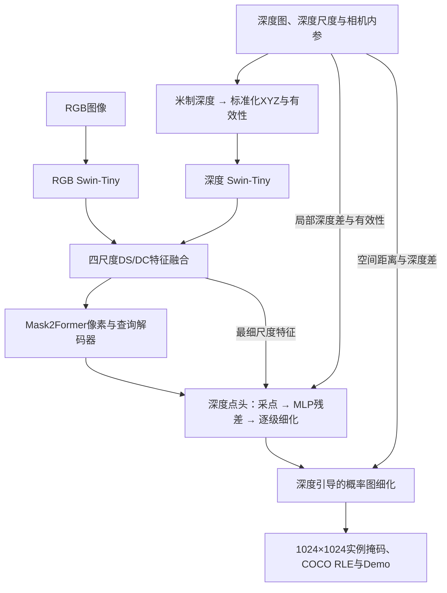

# DPSeg

**Depth-guided Point Refinement for Segmentation** · RGB-D 小目标实例分割与深度边界细化

课程 `component` 实例分割项目，包含 Mask R-CNN、Mask2Former、DA-Fusion 课程适配、深度点头和深度引导的掩码细化。提供训练与推理入口、完整验证结果、源码核验记录和离线交互 Demo。

## 任务与评价

任务是在合成渲染的电子元器件 RGB-D 图像中，分割单类 `component` 的每一个可见实例。图像与输出掩码尺寸均为1024×1024。

| 划分 | 图像数 | 用途 |
|---|---:|---|
| train | 14,432 | 基座微调与点头训练 |
| val | 2,584 | 选择模型、点头轮次和配置 |
| test | 2,112 | 生成课程竞赛提交 |

主指标是 **COCO Mask APₛ@[0.50:0.95]**，同时报告整体 Mask AP。IoU阈值从0.50到0.95、步长0.05；small按原图标注掩码面积 `[0, 32²]` 像素统计，每图最多100个预测实例。本文所有分数范围均为0–1。Kaggle公榜约使用30%的测试数据，不能直接与完整验证集或历史本地测试分数对应。

评价与提交格式详见[指标说明](docs/course_metric.md)。

## 技术路线

总体思路是：**先用双路网络融合外观与几何特征，再用深度点头修正掩码细节，最后用测量深度约束边界。** 对小目标额外提供切片推理方案。

### 1. 主干与掩码细化

下面是当前整图方案的结构。深度信息分别参与特征融合、可学习点细化和输出概率图细化。



| 环节 | 实现与作用 |
|---|---|
| RGB-D预处理 | 根据各图的 `depth_scale_m` 将深度转换为米，利用相机内参反投影为XYZ，并附加有效性通道；RGB与深度保持空间对齐。 |
| 双路特征提取 | 使用两套参数独立的Swin-Tiny，分别提取RGB外观与深度几何的四尺度特征。 |
| DS/DC融合 | DS为可变形自注意力，增强各模态自身特征；DC为双向可变形交叉注意力，让RGB与深度交换信息。四个尺度分别融合后送入解码器。 |
| 实例掩码预测 | Mask2Former像素解码器融合多尺度信息，查询解码器预测实例类别与粗掩码；基座训练使用集合匹配及分类、BCE、Dice损失。 |
| 深度点头 | 拼接细粒度特征、粗掩码预测和局部深度线索，用MLP预测残差，重点修正不确定位置。 |
| 概率图深度细化 | 对软概率图执行一次由空间距离与深度差加权的邻域平均，再阈值化，减少跨深度边界的掩码扩散。 |

课程适配采用双Swin-Tiny和XYZ表达，保留公开实现的四尺度DS/DC。与原论文的骨干、深度表达、训练配方及代码细节差异见[方法约定](docs/dafusion_method_contract.md)。

### 2. 深度点头如何训练和推理

点头借鉴[PointRend](https://arxiv.org/abs/1912.08193)的自适应点预测思路。当前实现是接在DA-Fusion上的残差改造：

- **共同输入：** 最细融合骨干特征96维、像素解码器特征256维，以及该实例的粗掩码logit。
- **额外深度输入：** 中心有效性、四邻域有符号深度差，以及四组中心和邻居同时有效的标记，共9维。深度差使用 `tanh(差值 / 1mm)` 压缩。
- **预测结构：** 3个256维隐藏层的共享MLP，各层再次拼入粗掩码logit，输出残差logit。末层零初始化，使初始预测保持原基座结果。
- **训练采样：** 每实例784个点，75%偏向不确定位置、25%随机采样，以点BCE监督。普通点头和深度点头共享冻结特征、匹配、采样位置与监督。
- **推理细化：** 从256×256粗掩码到512，再到1024逐级细化；每级每实例最多重新预测784个点。

推理区域来自预测掩码，只使用RGB、测量深度、有效性和相机内参。点头保留类别、置信度、实例数量和顺序，细化为空时回退。因此，它主要改善已发现目标的形状，无法通过新增实例找回完全漏检的目标。

概率图深度细化是后续的固定后处理：邻域半径2像素，空间标准差1.5像素，深度标准差0.001米，执行1次，最终阈值0.5；无效深度和空结果按规则回退。这里的概率细化替代旧的二值掩码深度修正，两种平滑不串联。

Mask2Former自身已借鉴PointRend的训练点采样来计算掩码损失；本项目增加的是**训练并在推理时运行的残差点头**。实现见[点头源码](rgbd_seg/course_point_refinement.py)、[概率图细化](rgbd_seg/course_tiled_probability.py)与[方法说明](docs/methods.md)。

### 3. 小目标切片推理

历史完整系统保留整图视图，并增加四个640×640角部切片。相邻切片重叠256像素，各切片按既定流程放大到1024输入模型，使小目标以更大的相对尺度进入网络。

1. RGB、深度、有效性同步裁剪，并按裁剪偏移更新相机内参。
2. 将各视图候选掩码还原到原图坐标，过滤触及内部裁剪边缘的实例。
3. 按原始分数选择代表实例，对跨视图mask IoU大于0.5的重复候选去重，保留前100个实例。
4. 固定候选来源、分数和顺序，再对对应视图中的实例应用深度点头与概率图深度细化。

这一流程用切片补充候选，用点头和概率细化改善形状。相关实现见[切片推理](rgbd_seg/course_tiled_probability.py)与[切片加点头](rgbd_seg/course_tiled_point.py)。已完成的切片评测使用第5轮基座和第2轮点头；第15轮基座加第6轮点头的切片结果正在补充评测。

## 消融实验与结果

<!-- progressive-ablation:start -->
### 五步累计消融（补充实验进行中）

按以下顺序逐步添加组件。每一行均保留上一行的全部组件，主表使用同一完整本地测试集的 Mask AP 与 APₛ。

| 编号 | 配置（累计添加） | 本地测试 AP | 本地测试 APₛ | APₛ 相对上一组增量 |
|---|---|---:|---:|---:|
| S0 | Mask2Former fine-tune | 补训中 | 补训中 | — |
| S1 | + RGB-D 融合（DA-Fusion课程适配） | 待统一评测 | 待统一评测 | — |
| S2 | + 深度点细化 | 待统一评测 | 待统一评测 | — |
| S3 | + 切片推理 | 补充评测中 | 补充评测中 | — |
| S4 | + 概率图深度细化 | 补充评测中 | 补充评测中 | — |

- **统一基座预算：** RGB 与 RGB-D 均使用 COCO 公开初始化、Swin-Tiny、1024 输入、完整训练集、15轮、全局 batch 33 和相同的两阶段 AdamW 学习率计划。主表固定各自第15轮权重。
- **固定后续组件：** S1–S4 共用同一个第15轮 RGB-D 基座；S2–S4 共用已按验证集选择的第6轮深度点头。S3关闭概率细化，S4仅追加固定概率图深度细化。
- **固定评价：** 先完成2,584张验证图的五组评价并锁定权重和配置，再计算2,112张本地测试图的COCO掩码指标。置信度阈值0.01，每图最多100个实例；不根据测试结果调参。
- **比较范围：** RGB-D增加第二路编码器及DS/DC融合；历史RGB-D与本次RGB训练的显卡及局部batch划分不同，不能视为逐步梯度完全一致的严格复现。点头另有6轮训练预算，切片增加推理计算量。

原RGB基线为800输入、5轮，故本次补训1024输入、15轮RGB基线；另补齐“深度点细化＋切片、关闭概率细化”的独立结果。完成后在本表填入实测值和五份CSV路径。

详细设置与进度见[五步消融记录](docs/results/progressive_ablation.md)。历史本地测试与Kaggle公榜分数来自不同评价范围，分别保存在[历史结果](docs/historical_results.md)。
<!-- progressive-ablation:end -->

点头类型、点头轮次、早期Mask R-CNN/Mask2Former/DA-Fusion基线，以及旧权重的切片实验，统一移至[补充实验](docs/results/ablation_background.md)。

## 安装

已验证环境为 Linux、Python 3.13.5、PyTorch 2.7.1、Transformers 4.53.2。单卡推理和四卡点头训练入口均已用真实数据检查。

```bash
git clone https://github.com/YuryLee/DPSeg.git
cd DPSeg

python3.13 -m venv .venv
source .venv/bin/activate

env -u HTTP_PROXY -u HTTPS_PROXY -u ALL_PROXY \
    -u http_proxy -u https_proxy -u all_proxy \
    python -m pip install -r requirements.txt \
    -i https://pypi.tuna.tsinghua.edu.cn/simple
```

安装使用[TUNA PyPI镜像](https://mirrors.tuna.tsinghua.edu.cn/help/pypi/)，命令取消当前代理环境变量。下载公开初始化权重的可选依赖在 `requirements-download.txt`，浏览器验收依赖在 `requirements-dev.txt`。

## 运行 Demo

准备课程 `blender.zip`、第15轮基座、第6轮点头和公开 COCO 初始化目录，详见[文件说明](docs/artifacts.md)。将下方路径换成各自文件的位置：

```bash
CUDA_VISIBLE_DEVICES=0 python tools/course_predict.py \
  --archive /path/to/blender.zip \
  --base-weights /path/to/epoch_15.pt \
  --head-weights /path/to/heads_epoch_06.pt \
  --coco-checkpoint /path/to/mask2former_swin_tiny_coco_instance \
  --device cuda:0 --indices 0,644,1292,2580 \
  --output outputs/course_demo
```

完成后打开 `outputs/course_demo/index.html`。页面自包含，可复制到其他电脑离线查看；浏览时无需 Python 或 GPU。支持六组方法对比、置信度和透明度调节、同步缩放、JSON与叠加图下载。


模型清单位于 [configs/course_e15_point.json](configs/course_e15_point.json)。加载器会验证基座、点头、冻结协议、源码及张量摘要，并把历史路径映射到当前项目和已安装的固定版本库。

## 训练与重新评测

[复现说明](docs/reproduction.md)提供以下流程：

1. 使用新训练入口做四卡工程检查：16张训练、8张验证、2次更新。
2. 将通过的工程收据传给完整六轮训练。
3. 用完整验证集选择点头，核对实际退出状态并审计全部训练和评分产物。
4. 使用 `tools/course_predict.py --all --evaluate --split val` 重新计算完整 COCO Mask AP/APₛ。

训练入口沿用原训练循环，仅适配文件位置。历史协议原始字节保留在 [artifacts/protocols](artifacts/protocols)，数据与权重通过显式参数提供。

## 已完成的软件检查

- 五项加载边界检查，包括源码变化、库文件迁移、错误基座配对和推理输入字段。
- 将源码复制到新目录后，8张验证图、6组方法共48份预测与原评分记录完全一致。
- 从实际 Git 提交检出到新目录后，386个文件字节一致；单张验证图的六组预测与原评分记录完全一致。
- 复制目录中的四卡工程运行通过完整审计。
- 离线浏览器检查通过：8个样例、6组方法、2,832个RLE掩码、单像素坐标、下载和手机布局。

详见[软件验收记录](docs/results/software_checks.json)。模型单元检查可运行：

```bash
python -m unittest tests.test_course_portable -v
```

## 项目目录

| 目录/文件 | 内容 |
|---|---|
| `rgbd_seg/course_portable.py` | 当前权重加载与六组推理路径 |
| `tools/course_predict.py` | 样例Demo、完整划分推理和验证评测 |
| `tools/course_train_points.py` | 工程检查与点头训练入口 |
| `web/course.html` | 离线交互界面 |
| `configs/course_e15_point.json` | 固定模型与指标清单 |
| `artifacts/protocols/` | 保留原始字节的训练协议 |
| `docs/results/` | 核验后的指标、报告和曲线 |
| `rgbd_seg/`、`tools/`、`tests/` | 各阶段模型、实验、校验及测试代码 |
| `third_party/` | 固定版本的第三方代码、来源记录与原许可证 |

本机原始数据、权重、大型逐图预测与历史运行目录由 Git 忽略。旧实验脚本和文档保留原有环境路径，用于追溯；当前跨目录运行入口见本页与复现说明。

## 结论范围

这是一次单种子、固定训练预算的课程实验。第6轮在本轮候选中最好，不据此宣称已收敛或达到统计显著。五步累计消融正在补齐RGB基线和切片对照；新增结果以实测记录为准。Kaggle公榜成绩须单独通过竞赛提交获得。

公开实现的课程适配与原论文设置存在差异，见[方法约定](docs/dafusion_method_contract.md)。第三方代码保留各自许可证；数据与课程训练权重由项目组按课程渠道共享。
