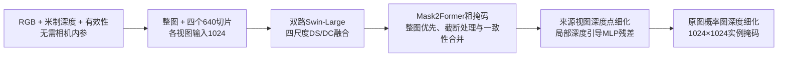
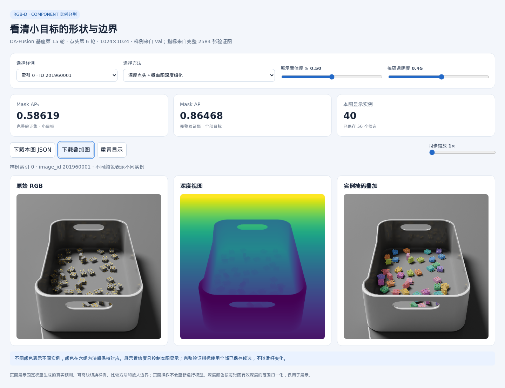

# DPSeg

**RGB-D Fusion and Depth-Guided Point Refinement for Small Object Instance Segmentation** · 无相机内参 RGB-D 小目标实例分割

课程 `component` 实例分割项目。当前完整版采用双路 **Swin-Large**，融合 RGB 与归一化米制深度，通过深度引导点细化、重叠切片推理和概率图深度细化生成实例掩码。训练和推理输入为 RGB、深度及有效性图，**无需读取、估计或提供相机内参**。仓库同时保留 Mask R-CNN、RGB Mask2Former 和原 Tiny＋XYZ 方案的对照代码、结果与 Demo。

## 当前 DPSeg 完整版

**Swin-Large＋无内参 RGB-D 融合＋深度感知点细化＋深度感知概率图细化＋切片增强推理**。切片固定为整图＋四个 640×640 角部视图，当前合并采用 **整图优先＋截断处理＋跨视图一致性**（`global_guard_edge_consensus`）。基座训练 15 轮，冻结后训练点细化头 6 轮；第 6 轮点头依据完整验证集选择。合并策略由用户在查看探索性本地测试结果后指定为当前默认。

| 评价来源 | 当前合并策略 Mask AP | 当前合并策略 Mask APₛ |
|---|---:|---:|
| 完整本地测试集，2,112 张 | **0.887453** | **0.528710** |
| 完整验证集，2,584 张 | 待测 | 待测 |
| Kaggle 比赛 `rgb-d-333` 公榜 | — | 尚未提交当前配置 |

当前测试 CSV 已完成全量 RLE 校验，并与评分预测逐行绑定。[当前基线与模块消融表、CSV 路径](docs/results/course_baselines_removal_current.md) · [当前结果摘要](docs/results/course_baselines_removal_current.json) · [合并策略对照](docs/results/course_guarded_merge640.md)。

**历史分数来源：** 旧分数优先的跨视图掩码 IoU 合并得到验证 AP/APₛ=0.885717/0.702910、本地测试 AP/APₛ=0.880289/0.525286，以及 Kaggle 公榜 APₛ=0.56785（提交 57967712，COMPLETE）。这些数值均属于旧合并策略，不能作为当前配置的验证或公榜结果。[历史完整实验](docs/results/swinl_depth_no_k.md) · [历史 Kaggle 回执](docs/results/kaggle_swinl_depth_no_k_rgb_d_333.json)。

## 任务与评价

任务是在合成渲染的电子元器件 RGB-D 图像中，分割单类 `component` 的每一个可见实例。图像与输出掩码尺寸均为1024×1024。

| 划分 | 图像数 | 用途 |
|---|---:|---|
| train | 14,432 | 基座微调与点头训练 |
| val | 2,584 | 选择模型、点头轮次和配置 |
| test | 2,112 | 生成课程竞赛提交 |

主指标是 **COCO Mask APₛ@[0.50:0.95]**，同时报告整体 Mask AP。IoU阈值从0.50到0.95、步长0.05；small按原图标注掩码面积 `[0, 32²]` 像素统计，每图最多100个预测实例。本文所有分数范围均为0–1。Kaggle 公榜按对应比赛的公开评分部分计算，与完整验证集、本地测试及其他比赛成绩分别报告。

评价与提交格式详见[指标说明](docs/course_metric.md)。

## 技术路线

当前完整版的路线为：**无内参深度表示 → 双路 Swin-Large 与 DS/DC 融合 → 整图和重叠切片候选 → 整图优先、截断处理与一致性合并 → 深度引导点细化 → 概率图深度细化**。切片参考 [SAHI](https://arxiv.org/abs/2202.06934) 的推理思路，并为多模态输入和来源视图点细化定制实现。



### 1. 无内参深度表示与 RGB-D 融合

根据各图的 `depth_scale_m` 将原始 uint16 深度转换为米，并保留有效性图。每个视图缩放后，在有效深度上减去中位数，再除以绝对偏差的第 95 百分位数加 1e-6；将归一化 Z 重复为三个通道，并附上有效性通道，经 4→3 输入适配器进入深度分支。这一表示不进行 XYZ 反投影，不使用焦距、主点或估计内参。

RGB 与深度使用两套参数独立的 Swin-Large，均由同一公开 COCO 初始化的骨干权重开始课程训练。四个尺度上，DS（可变形自注意力）聚合模态内特征，DC（双向可变形交叉注意力）交换颜色与几何信息；融合结果交给 Mask2Former 的像素和查询解码器。训练保留原生集合匹配、分类、掩码 BCE/Dice 及辅助层监督。

DS/DC 沿用 DA-Fusion 的融合机制；本项目使用无内参深度表示、课程单类解码和对应训练流程。[无内参编码与骨干实现](rgbd_seg/course_depth_backbone.py) · [原论文与实现约定](docs/dafusion_method_contract.md)。

### 2. 深度引导点细化

点细化借鉴 [PointRend](https://arxiv.org/abs/1912.08193) 的不确定点选择思路。冻结本组第 15 轮 RGB-D 基座后，训练配套的残差点细化头：

- **共同输入：** Large 最细融合特征 192 维、像素解码器特征 256 维，以及该实例的原始粗掩码 logit。
- **局部深度输入：** 中心有效性、四邻域有符号深度差和四组配对有效性，共 9 维；有效深度差经 `tanh(差值 / 0.001米)` 压缩。
- **结构：** 三个 256 维隐藏层及一个输出层，各隐藏层后再次拼接粗掩码 logit，输出掩码残差；输出层零初始化。
- **采样与监督：** 每实例 784 点，75% 偏向不确定位置、25% 随机，以点 BCE 监督；普通点头与深度点头共享冻结特征、匹配、采样及监督规则。
- **推理：** 区域由预测掩码确定，粗掩码从 256×256 逐级细化到 512、1024，每级每实例最多修正 784 点；类别、分数及候选顺序保持不变，空掩码按既定规则回退。

当前模型的点头读取 RGB、测量深度及有效性所形成的特征，无需相机内参。Large 的点头特征维度为 448，须与配套基座一起使用；原 Tiny 点头的特征维度为 352。[支持两种骨干的点细化实现](rgbd_seg/course_depth_backbone_points.py)。

### 3. 切片推理：补充小目标候选

保留 1024×1024 整图，并增加四个 640×640 角部切片，相邻切片重叠 256 像素。RGB、米制深度和有效性图同步裁剪，各切片放大到 1024 输入模型，逐视图完成粗预测；每个视图独立进行无内参深度归一化。

预测缩回切片尺寸并映射到原图，先沿用触及内部裁剪边缘 2 像素的过滤，再进行当前的 **整图优先＋截断处理＋一致性** 合并：

- **整图优先：** 预测分数≥0.5、原图掩码面积>1,024 像素的整图候选优先参与去重；这是可靠性启发式，不保证整图掩码一定正确。
- **截断处理：** 距内部裁剪边界≤8 像素的切片候选，选择优先级乘以 0.75；若其至少 80% 的面积被受保护整图掩码包含，且整图掩码面积至少为它的 1.5 倍，则剔除这一疑似截断片段。原图外边界不在此范围。
- **跨视图一致性：** 与其他视图中分数≥0.5 的候选计算最大掩码 IoU；最大值<0.5 时一致性记为 0，否则使用该值。选择优先级乘以 `0.75＋0.25×一致性`。

优先级只用于选择代表候选；对跨视图掩码 IoU 严格大于 0.5 的候选进行贪心去重，同视图不在此步骤抑制。最后恢复原始置信度排序，最多输出 100 个实例，既不修改提交分数，也不执行掩码并集。候选保留来源视图、查询编号和对应特征，供后续点细化读取。

本流程参考 SAHI 的整图与重叠切片推理思路，RGB-D 对齐、掩码去重和来源特征缓存采用自定义实现。置信度阈值为 0.01；案例页面的 0.50 是展示阈值。[当前运行时](rgbd_seg/course_dpseg.py) · [候选选择实现](rgbd_seg/course_guarded_merge.py)。

### 4. 概率图深度细化：约束最终轮廓

将来源视图点细化后的软概率还原至原图，以空间距离和原始米制深度差决定邻域权重，执行一次联合加权，再以 0.5 阈值生成二值掩码。邻域半径 2 像素、空间标准差 1.5 像素、深度标准差 0.001 米；无效深度、平票与空掩码保留既定回退规则。该步骤不读取相机内参。

概率图细化保持候选、类别、分数和排序，处理的是软掩码概率。它替代历史二值深度平滑。[概率图深度细化实现](rgbd_seg/course_tiled_probability.py)。

### 训练与推理顺序

训练先完成 15 轮基座微调，再冻结基座训练 6 轮点细化头；切片和概率图细化仅用于推理。完整推理顺序为：**五视图粗预测 → 原图映射与筛选 → 候选来源视图点细化 → 原图概率图深度细化 → COCO RLE**。

当前完整推理入口为 [predict_dpseg.py](tools/predict_dpseg.py)，默认配置见 [dpseg_current.json](configs/dpseg_current.json)。训练与历史评测入口见 [基座训练](tools/run_course_depth_backbone.py)、[点头训练与完整系统评测](tools/run_course_depth_backbone_system.py)和 [Large＋无内参实验控制程序](tools/run_course_swinl_depth_no_k.py)。控制程序保留原实验目录和冻结协议约定，重新运行前须按自己的数据与权重位置准备配置。[文件及权重说明](docs/artifacts.md)。

## 消融实验与结果

[论文用五组消融汇总表](docs/results/course_ablation_groups_current.md) · [可编辑 Word 表格](docs/images/ablation_groups_current.docx) · [点头类型消融](docs/results/course_point_heads_swinl_current.md) · [当前完整配置的相机内参对比](docs/results/course_intrinsics_swinl_current.md)。

<!-- cumulative-main:start -->
### 基线对比与累计模块消融结果

统一采用 **Swin-Large、无需相机内参的深度输入、完整本地测试集2,112张**。每行在上一行基础上增加模块；S4使用当前640×640切片及整图优先＋截断处理＋跨视图一致性合并。

| 方法 | APₛ ↑ | ARₛ ↑ | AP ↑ |
|---|---:|---:|---:|
| S0：Mask2Former | 0.205838 | 0.293236 | 0.734611 |
| S1：+ RGB-D 融合（DA-Fusion） | 0.408797 | 0.481296 | 0.845626 |
| S2：+ 深度感知点细化 | 0.403831 | 0.481031 | 0.862922 |
| S3：+ 深度感知概率图细化 | 0.476384 | 0.569641 | 0.886068 |
| **S4：+ 切片增强推理（DPSeg）** | **0.528710** | **0.674606** | **0.887453** |

S1→S2的小目标APₛ下降0.004966，整体AP提高0.017296；本表反映各模块在既定组合下的累计变化。完整版相对DA-Fusion的APₛ、ARₛ、AP分别提高0.119913、0.193310、0.041826。

RGB和RGB-D基座均使用最终第15轮权重；S2–S4共用验证集选定的第6轮深度点头。 表中添加顺序用于实验对比；完整推理仍先合并候选，再做来源视图点细化及原图概率图细化。当前合并由用户根据已查看的本地测试对比指定，Kaggle与验证集成绩另行列报。

[累计结果与五份CSV](docs/results/course_ablation_swinl_current.md) · [指标CSV](docs/results/course_ablation_swinl_current.csv) · [来源JSON](docs/results/course_ablation_swinl_current.json)。已完成的[七组独立去除模块实验](docs/results/course_baselines_removal_current.md)作为补充结果保留。
<!-- cumulative-main:end -->

<!-- tile-overlap:start -->
### 固定四切片的重叠率与尺寸对照

固定当前DPSeg完整版：Swin-Large＋无内参深度、整图保护＋截断处理＋跨视图一致性合并、来源视图点细化及深度感知概率图细化。每档均为整图＋四个四角切片，共5视图，切片完整覆盖1024×1024原图；各视图统一缩放到1024×1024输入。基座第15轮、点头第6轮，在完整本地测试集2,112张上比较。40%档复用此前已核验的全部预测。

| 目标重叠率 | 实际重叠率 | 切片尺寸 | 视图数 | APₛ ↑ | ARₛ ↑ | AP ↑ |
|---:|---:|---:|---:|---:|---:|---:|
| 0% | 0.0000% | 512×512 | 5 | 0.479386 | 0.638129 | 0.880584 |
| 20% | 20.0351% | 569×569 | 5 | 0.504851 | 0.663131 | 0.880736 |
| **40%（当前默认）** | **40.0000%** | **640×640** | **5** | **0.528710** | **0.674606** | **0.887453** |
| 60% | 59.9179% | 731×731 | 5 | 0.514244 | 0.657701 | 0.888141 |
| 80% | 79.9531% | 853×853 | 5 | 0.503422 | 0.609516 | 0.890626 |

本轮五档中，整体AP最高出现在目标重叠率 80%（AP=0.890626）；APₛ最高出现在 40%（APₛ=0.528710）。这是本轮已观察测试集的描述性比较，当前默认保持40%。

固定四片和完整覆盖时，切片尺寸、实际重叠率与目标在输入中的相对尺度一起改变，因此该实验是不同切片几何设置的条件比较，不能解释为重叠率的独立因果作用。规则在推理前冻结，没有根据本轮测试结果调参或自动更换默认，不作为验证选出的最优配置。

[完整指标、窗口设置、核验及CSV路径](docs/results/course_overlap_swinl.md) · [指标CSV](docs/results/course_overlap_swinl.csv) · [核验JSON](docs/results/course_overlap_swinl.json)。
<!-- tile-overlap:end -->

<!-- tile-size:start -->
### 历史切片尺寸敏感性分析（旧分数优先合并）

下表保留原分数优先合并的尺寸对比；它不代表当前整图优先策略的结果。固定旧完整 DPSeg 的 Swin-Large＋无内参深度、第 15 轮基座与第 6 轮点头，保留两种掩码细化。在完整本地测试集 **2,112 张图**上比较切片尺寸，数值范围 0–1。512、768 重新推理；640 的窗口和完整流程与当时已完成的默认配置完全一致，复用其全量结果并通过样例复现核验。

| 切片尺寸 | 每图视图数（含整图） | APₛ ↑ | ARₛ ↑ | AP ↑ |
|:---:|:---:|:---:|:---:|:---:|
| 512×512 | 10 | 0.490499 | 0.675241 | 0.852428 |
| 640×640（原基准） | 5 | 0.525286 | 0.674087 | 0.880289 |
| 768×768 | 5 | 0.518685 | 0.647804 | 0.888220 |

三组中 APₛ 最高的是 **640**，ARₛ 最高的是 **512**，整体 AP 最高的是 **768**。不同尺寸的优势取决于评价指标。512 虽然有更多切片并将目标放得更大，APₛ 仍低于 640；切片更小不保证本任务的分割精度更高。

- 512 相对 640：APₛ **-0.034787**，ARₛ **+0.001154**，AP **-0.027861**。
- 768 相对 640：APₛ **-0.006601**，ARₛ **-0.026283**，AP **+0.007931**。

本轮固定名义重叠率 20%，采用滑窗步长并将末端窗口移至图像边界。**实际重叠和视图数量会随尺寸变化，结果同时反映尺度、覆盖和候选数量的影响，不能当作同计算量的纯尺度比较。**这是在已查看过结果的本地测试集上追加的敏感性分析，没有依据这张表更换默认配置；若要选择新的切片参数，应另在验证集确认。分数与 Kaggle 公榜分开报告。

[窗口几何、核验和 CSV 路径](docs/results/course_tile_size_swinl.md) · [结果 CSV](docs/results/course_tile_size_swinl.csv) · [结果 JSON](docs/results/course_tile_size_swinl.json)。
<!-- tile-size:end -->

<!-- sahi-merge:start -->
### 历史官方 SAHI 后处理对比

本表比较旧分数优先掩码合并与官方 SAHI 后处理，保留当时的结果；当前整图优先策略不在本轮比较中。固定 Swin-Large＋无内参深度、第 15 轮基座与第 6 轮点头，在完整本地测试集 **2,112 张图**上比较官方 SAHI 后处理与对照配置。各组均保留整图和四个 640×640 角点切片、来源视图点细化及深度感知概率图细化。分数范围 0–1，加粗标记原完整配置。

| 方法 | APₛ ↑ | ARₛ ↑ | AP ↑ |
|:---:|:---:|:---:|:---:|
| **旧完整 DPSeg（分数优先合并）** | **0.525286** | **0.674087** | **0.880289** |
| 提前 SAHI NMS（框 IoU） | 0.488231 | 0.651149 | 0.861288 |
| 延后掩码 NMS（顺序对照） | 0.525101 | 0.672700 | 0.879204 |
| 延后掩码 NMS＋多边形转换（表示对照） | 0.524663 | 0.670710 | 0.878570 |
| 延后 SAHI NMS（框 IoS） | 0.253917 | 0.285276 | 0.736970 |
| 延后 SAHI GreedyNMM（框 IoS） | 0.157502 | 0.186821 | 0.557821 |

本表六组中，APₛ 最高为 **旧完整 DPSeg（分数优先合并）**，ARₛ 最高为 **旧完整 DPSeg（分数优先合并）**，整体 AP 最高为 **旧完整 DPSeg（分数优先合并）**。

本轮调用 **SAHI 0.14.0 的官方 NMSPostprocess、GreedyNMMPostprocess 类**，RGB-D 输入和切片前向仍由 DPSeg 负责，未调用完整 get_sliced_prediction 接口。这是在已查看过结果的本地测试集上追加的固定权重比较；没有根据本表调阈值、选择检查点或替换默认配置。单种子结果不代表统计显著性，Kaggle 成绩另行报告。共享特征的实验运行时间不用于速度比较。

五视图合计产生 **442,955** 个候选记录；同一物体在不同视图中可能重复出现。对全部细化候选进行官方多边形转换后，**2,911** 个候选因无法形成多边形而丢弃，**111,846** 个仍保留候选的掩码发生变化。转换累计增加 **0** 个掩码像素、移除 **429,160** 个掩码像素；这些是合并前的表示转换统计，不包含 GreedyNMM 多边形并集后的拓扑或栅格化变化。移除量包含丢弃候选的像素，各候选分别计数，不是唯一物体数或图像覆盖面积。

[对照顺序、核验、依赖及 CSV 路径](docs/results/course_sahi_merge.md) · [指标 CSV](docs/results/course_sahi_merge.csv) · [核验 JSON](docs/results/course_sahi_merge.json)。
<!-- sahi-merge:end -->

### 历史去内参与 Swin-Large 补充对比

本节所有完整配置使用旧分数优先合并；当前合并下的 Swin-Large 有无内参对照已完成，见[当前完整配置的深度表示对比](docs/results/course_intrinsics_swinl_current.md)。本节其余历史骨干组合保持原协议。三组补充实验均已完成 15 轮基座训练、6 轮点细化训练，以及完整验证和测试；点头仅依据验证集选择。下表统一使用课程归档中的本地测试标注（2,112 张图），分数范围 0–1。

| 骨干与深度表示 | 推理配置 | Mask AP | Mask APₛ |
|---|---|---:|---:|
| 原 Swin-Tiny，内参反投影 XYZ | 基础配置 | 0.817895 | 0.368086 |
| 新 Swin-Tiny，无内参深度 | 基础配置 | 0.820201 | 0.362218 |
| 新 Swin-Large，内参反投影 XYZ | 基础配置 | 0.835743 | 0.393056 |
| 新 Swin-Large，无内参深度 | 基础配置 | 0.845626 | 0.408797 |
| 原 Swin-Tiny，内参反投影 XYZ | 完整配置 | 0.868243 | 0.488299 |
| 新 Swin-Tiny，无内参深度 | 完整配置 | 0.872224 | 0.488260 |
| 新 Swin-Large，内参反投影 XYZ | 完整配置 | 0.863532 | 0.499089 |
| 新 Swin-Large，无内参深度 | 完整配置 | **0.880289** | **0.525286** |

完整配置包含深度点细化、切片推理和概率图深度细化。Large＋无内参在上表完整配置中的 AP 和 APₛ 均最高；相对 Large＋XYZ 分别增加 0.016757 和 0.026197，相对原 Tiny＋XYZ 分别增加 0.012046 和 0.036986。三组补充实验的六份 CSV 均已逐掩码解码并从 CSV 独立运行 COCO 复评，AP 和 APₛ 差异均为 0。这些是本地测试结果，Kaggle 成绩另行报告。本轮为单种子实验，预训练、深度表示和微批布局等比较限制及 CSV 路径见[补充对比记录](docs/results/depth_backbone_comparison.md)和[Large＋无内参结果](docs/results/swinl_depth_no_k.md)。下方效率表与当前累计主表的五组配置及最终权重一致。

使用旧分数优先合并的 Large＋无内参完整版已于 2026-11-04 提交到新比赛 [RGB-D图像分割-333](https://www.kaggle.com/competitions/rgb-d-333)，公榜 APₛ 为 **0.56785**，提交编号 **57967712**，状态 COMPLETE。查询时队伍“21”位列第 1／3 队；排名会随其他提交变化。该成绩属于新比赛，与上方本地测试及旧比赛 `rgb-d` 的成绩分别报告。[提交与文件校验记录](docs/results/kaggle_swinl_depth_no_k_rgb_d_333.json)。

<!-- inference-efficiency:start -->
### 模型规模与推理开销对比

统一使用 **NVIDIA A100-PCIE-40GB 单卡、FP32、batch=1、1024×1024模型输入**。从验证集固定选取32张等间隔图像，预热5张后重复3轮，每组共96次计时。五组按相同图片与顺序独立执行，完整版使用整图＋4个640×640切片、40%重叠，采用整图优先＋截断处理＋跨视图一致性合并。

| 配置 | 参数量（M） | 推理权重（MiB） | 平均耗时（ms/图）↓ | FPS ↑ |
|---|---:|---:|---:|---:|---:|
| S0：Mask2Former | 215.502 | 826.23 | 418.5 | 2.39 |
| S1：+ RGB-D 融合（DA-Fusion） | 460.955 | 1766.71 | 850.9 | 1.18 |
| S2：+ 深度感知点细化 | 461.205 | 1767.67 | 998.4 | 1.00 |
| S3：+ 深度感知概率图细化 | 461.205 | 1767.67 | 1185.7 | 0.84 |
| **S4：+ 切片增强推理（DPSeg）** | 461.205 | 1767.67 | 4691.1 | 0.21 |

RGB和RGB-D基座均使用最终第15轮权重；S2–S4共用验证集选定的第6轮深度点头。

参数量包含冻结骨干；推理权重统计基座文件及实际使用的深度点头独立文件，不计优化器和未使用的普通点头。点头增加249,858个参数，概率图细化与切片不增加参数。计时包含预处理、GPU前向、适用的细化/切片/合并、结果传回CPU和COCO RLE编码；排除图片读取与解码、模型加载、文件写入、一致性核对及AP评分。不统计GPU峰值显存。FPS按每张完整原图计算，为1000除以平均毫秒数。

本轮五组统一实测，旧合并的4794.0 ms/图保留在历史报告中。测速样本与重复用于衡量运行时间，不构成新增完整验证集精度结果。

[当前效率报告](docs/results/course_efficiency_swinl_current.md) · [CSV](docs/results/course_efficiency_swinl_current.csv) · [JSON](docs/results/course_efficiency_swinl_current.json) · [历史效率记录](docs/results/course_efficiency_swinl.md)。
<!-- inference-efficiency:end -->

当前 Large 点头类型见[本轮完整流程对照](docs/results/course_point_heads_swinl_current.md)。历史点头类型、点头轮次、早期 Mask R-CNN/Mask2Former/DA-Fusion 基线及旧权重的切片实验见[补充实验](docs/results/ablation_background.md)。

## 安装

已验证环境为 Linux、Python 3.13.5、PyTorch 2.7.1、Transformers 4.53.2。原 Tiny 单卡推理与四卡点头入口、当前 Large 无内参双卡训练与完整评测均已在真实数据上运行。

```bash
git clone https://github.com/YuryLee/DPSeg.git
cd DPSeg

python3.13 -m venv .venv
source .venv/bin/activate

env -u HTTP_PROXY -u HTTPS_PROXY -u ALL_PROXY \
    -u http_proxy -u https_proxy -u all_proxy \
    python -m pip install -r requirements.txt \
    -i https://pypi.tuna.tsinghua.edu.cn/simple
```

安装使用[TUNA PyPI镜像](https://mirrors.tuna.tsinghua.edu.cn/help/pypi/)，命令取消当前代理环境变量。下载公开初始化权重的可选依赖在 `requirements-download.txt`，浏览器验收依赖在 `requirements-dev.txt`。补充 UOIS/UOAIS 评测与相关检查需要 `requirements-benchmark.txt` 中的图像处理依赖，可在上述安装命令中替换依赖文件名。

## 模型权重

消融实验权重见 [Hugging Face](https://huggingface.co/Lemma456/DPSeg)。原 Tiny＋XYZ 主消融 S0–S4 共用三份权重，合计约518 MiB：第15轮RGB基线、第15轮RGB-D基座、配套第6轮普通／深度点头。切片和概率图细化不增加权重。

Hugging Face 上现有的 `weights-v1` 对应原 Tiny＋XYZ 五步消融。当前 Large＋无内参基座与点头保存在本机实验目录，尚未发布到该权重版本；文件位置与校验值见[模型权重说明](docs/model_weights.md)。

```bash
python tools/fetch_released_weights.py # 主消融三份权重
```

## 当前完整版推理

本机已保存当前 Large＋无内参模型、点头和课程归档，默认路径见 `configs/dpseg_current.json`。先核对文件，再生成少量样例：

```bash
python tools/predict_dpseg.py check-manifest --verify-weights
CUDA_VISIBLE_DEVICES=0 python tools/predict_dpseg.py dataset \
  --split val --indices 0,644 --output outputs/dpseg_current_examples
```

生成完整测试集提交和本地指标：

```bash
CUDA_VISIBLE_DEVICES=0 python tools/predict_dpseg.py dataset \
  --split test --all --evaluate --output outputs/dpseg_current_test
```

按实际空闲设备设置 `CUDA_VISIBLE_DEVICES`，输出目录须尚不存在。入口输出 `predictions.jsonl`、`submission.csv`、RLE 校验及运行记录；只有完整 test CSV 可作为整组提交。默认采用 40% 重叠、四个 640×640 切片和当前合并策略。可用 `--overlap 0`、`0.2`、`0.4`、`0.6` 或 `0.8` 做固定四片对照；每档都覆盖原图，改变重叠率也会改变切片尺寸。

这是使用本机 Large 实验产物的入口。迁移数据可使用 `--archive`；`--base-weights` 和 `--head-weights` 只接受相同校验值的权重。原训练协议及公开初始化目录也须保留；当前 Large 权重尚未发布到 Hugging Face 的 Tiny 权重版本。

## 运行 Demo

### GT与五阶段消融案例展台

这一图库展示原 Tiny＋XYZ 的 S0–S4 固定预测。用于课堂展示的 12 个精选案例包含3个分割良好的案例、4个漏检改善案例、2个误检案例、2个边界改善案例，以及1个仍未解决的漏检案例。
每例提供RGB、原始深度、GT、S0–S4预测、独立二值掩码和可用于PPT的对比图。网页支持局部放大、整图对照、纯掩码、轮廓和误差着色。

本地入口为 `outputs/course_showcase_test_v1/index.html`；打包文件为 `outputs/DPSeg_case_demo_v1.zip`。解压后双击 `index.html` 即可离线演示。
查看[案例清单与解释](docs/results/showcase_cases.md)和[演示说明](docs/demo_usage.md)。
案例GT来自课程下载归档中已有的test标注；这些定性案例不能替代完整测试集AP或Kaggle评分。

### 从原 Tiny 模型生成预测演示

准备课程 `blender.zip`、第15轮基座、第6轮点头和公开 COCO 初始化目录，详见[文件说明](docs/artifacts.md)。将下方路径换成各自文件的位置：

```bash
CUDA_VISIBLE_DEVICES=0 python tools/course_predict.py \
  --archive /path/to/blender.zip \
  --base-weights /path/to/epoch_15.pt \
  --head-weights /path/to/heads_epoch_06.pt \
  --coco-checkpoint /path/to/mask2former_swin_tiny_coco_instance \
  --device cuda:0 --indices 0,644,1292,2580 \
  --output outputs/course_demo
```

完成后打开 `outputs/course_demo/index.html`。页面自包含，可复制到其他电脑离线查看；浏览时无需 Python 或 GPU。支持六组方法对比、置信度和透明度调节、同步缩放、JSON与叠加图下载。



模型清单位于 [configs/course_e15_point.json](configs/course_e15_point.json)。加载器会验证基座、点头、冻结协议、源码及张量摘要，并把历史路径映射到当前项目和已安装的固定版本库。

## 训练与重新评测

[复现说明](docs/reproduction.md)提供以下流程：

1. 使用新训练入口做四卡工程检查：16张训练、8张验证、2次更新。
2. 将通过的工程收据传给完整六轮训练。
3. 用完整验证集选择点头，核对实际退出状态并审计全部训练和评分产物。
4. 使用 `tools/course_predict.py --all --evaluate --split val` 重新计算完整 COCO Mask AP/APₛ。

训练入口沿用原训练循环，仅适配文件位置。历史协议原始字节保留在 [artifacts/protocols](artifacts/protocols)，数据与权重通过显式参数提供。

## 已完成的软件检查

- 五项加载边界检查，包括源码变化、库文件迁移、错误基座配对和推理输入字段。
- 将源码复制到新目录后，8张验证图、6组方法共48份预测与原评分记录完全一致。
- 从实际 Git 提交检出到新目录后，386个文件字节一致；单张验证图的六组预测与原评分记录完全一致。
- 复制目录中的四卡工程运行通过完整审计。
- 离线浏览器检查通过：8个样例、6组方法、2,832个RLE掩码、单像素坐标、下载和手机布局。

详见[软件验收记录](docs/results/software_checks.json)。模型单元检查可运行：

```bash
python -m unittest tests.test_course_portable -v
```

## 项目目录

| 目录/文件 | 内容 |
|---|---|
| `rgbd_seg/course_dpseg.py`、`tools/predict_dpseg.py` | 当前 Large＋无内参完整版及整图优先合并入口 |
| `configs/dpseg_current.json` | 当前完整模型与合并策略清单 |
| `rgbd_seg/course_portable.py` | 原 Tiny 权重加载与六组推理路径 |
| `tools/course_predict.py` | 样例Demo、完整划分推理和验证评测 |
| `tools/course_train_points.py` | 工程检查与点头训练入口 |
| `web/course.html` | 离线交互界面 |
| `configs/course_e15_point.json` | 固定模型与指标清单 |
| `artifacts/protocols/` | 保留原始字节的训练协议 |
| `docs/results/` | 核验后的指标、报告和曲线 |
| `rgbd_seg/`、`tools/`、`tests/` | 各阶段模型、实验、校验及测试代码 |
| `third_party/` | 固定版本的第三方代码、来源记录与原许可证 |

本机原始数据、权重、大型逐图预测与历史运行目录由 Git 忽略。旧实验脚本和文档保留原有环境路径，用于追溯；当前跨目录运行入口见本页与复现说明。

## 结论范围

这是一次单种子、固定训练预算的课程实验。第6轮在本轮候选中最好，不据此宣称已收敛或达到统计显著。当前主表采用S0–S4累计式消融，五组完整本地测试与统一推理测速均已完成；七组独立去除实验保留作补充。当前合并尚无新的完整验证集精度结果。当前合并由用户根据探索性测试结果指定，不能声称所有配置均通过验证集选优。Kaggle公榜成绩须单独通过竞赛提交获得。

公开实现的课程适配与原论文设置存在差异，见[方法约定](docs/dafusion_method_contract.md)。第三方代码保留各自许可证；课程数据按课程渠道取得，已训练权重见[权重说明](docs/model_weights.md)。
