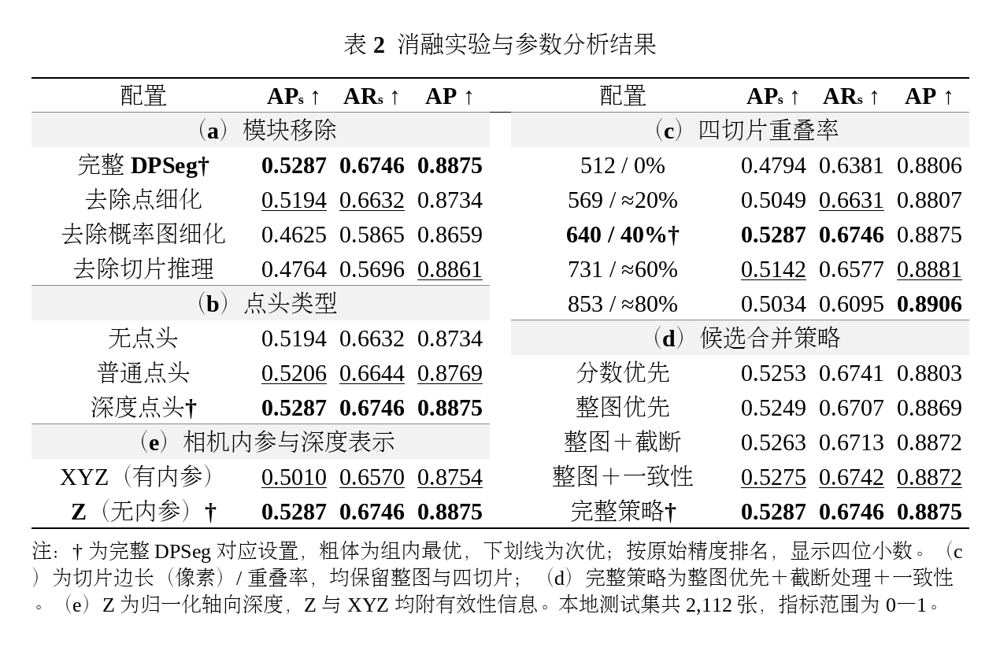

# 消融实验与参数分析：论文用表

本表按实验类型分组，每组均保留完整 DPSeg 对应配置。粗体为组内最优，下划线为次优，按未舍入数值排名。默认设置为 Swin-Large、无内参深度、第 15 轮基座、第 6 轮深度点头、整图＋四个 640×640 切片、40% 重叠率、整图优先＋截断处理＋一致性，以及深度感知点细化和深度感知概率图细化。

全部数值来自完整本地测试集 2,112 张图，COCO 掩码指标范围为 0—1，每图最多 100 个实例。本表保留六位小数；Word 紧凑版保留四位小数。

[下载可编辑 Word 表格](../images/ablation_groups_current.docx) · [查看排版示意](../images/ablation_groups_current.png)

| 实验组 | 配置 | APₛ ↑ | ARₛ ↑ | AP ↑ |
|---|---|---:|---:|---:|
| （a）模块移除 | 完整 DPSeg（默认） | **0.528710** | **0.674606** | **0.887453** |
|  | w/o 深度感知点细化 | <u>0.519366</u> | <u>0.663216</u> | 0.873441 |
|  | w/o 深度感知概率图细化 | 0.462478 | 0.586535 | 0.865874 |
|  | w/o 切片增强推理 | 0.476384 | 0.569641 | <u>0.886068</u> |
| （b）点头类型 | 无点细化头 | 0.519366 | 0.663216 | 0.873441 |
|  | 普通点细化头 | <u>0.520640</u> | <u>0.664380</u> | <u>0.876872</u> |
|  | 深度感知点细化头（默认） | **0.528710** | **0.674606** | **0.887453** |
| （c）四切片重叠率 | 512×512，0% | 0.479386 | 0.638129 | 0.880584 |
|  | 569×569，20.0351% | 0.504851 | <u>0.663131</u> | 0.880736 |
|  | 640×640，40%（默认） | **0.528710** | **0.674606** | 0.887453 |
|  | 731×731，59.9179% | <u>0.514244</u> | 0.657701 | <u>0.888141</u> |
|  | 853×853，79.9531% | 0.503422 | 0.609516 | **0.890626** |
| （d）候选合并策略 | 原始分数优先跨视图掩码去重 | 0.525286 | 0.674087 | 0.880289 |
|  | 整图优先 | 0.524875 | 0.670700 | 0.886913 |
|  | 整图优先＋截断处理 | 0.526284 | 0.671324 | 0.887154 |
|  | 整图优先＋跨视图一致性 | <u>0.527541</u> | <u>0.674225</u> | <u>0.887230</u> |
|  | 整图优先＋截断处理＋一致性（默认） | **0.528710** | **0.674606** | **0.887453** |
| （e）相机内参与深度表示 | XYZ＋有效性，有内参 | <u>0.501000</u> | <u>0.656992</u> | <u>0.875379</u> |
|  | 归一化 Z＋有效性，无内参（默认） | **0.528710** | **0.674606** | **0.887453** |

## 比较条件

- **模块移除：** 固定权重，分别关闭点细化、概率图细化或切片推理；不把这些结果表述为独立重训模型。
- **点头类型：** 普通与深度点头均读取 448 维 RGB-D 特征和粗掩码 logit，深度点头额外输入 9 维局部深度线索；分别为 247,554 和 249,858 个参数。两者固定第 6 轮，普通点头不宣称是其单独的验证最优检查点。
- **四切片：** 保留整图和四个角点切片并完整覆盖原图；重叠率、切片尺寸及放大倍数共同变化。各视图缩放为 1024×1024。
- **候选合并：** 固定视图、权重与两种细化，仅比较本表列出的五种候选选择规则；排序优先级不改变输出原始置信度。
- **相机内参：** 两组均使用完整流程和配套权重；深度表示与预处理同时变化，不是单独删除内参的对照。

各组重复出现的完整配置、无点头结果为同一测量的复用，不是新增独立重复实验。测试集此前已被查看，本表是单种子描述性分析；Kaggle 得分另行列报。

## 结果与实现入口

- [独立模块消融](course_baselines_removal_current.md)
- [点头类型](course_point_heads_swinl_current.md)
- [四切片重叠率](course_overlap_swinl.md)
- [合并策略原始实验记录](course_guarded_merge640.md)
- [当前完整配置的内参对照](course_intrinsics_swinl_current.md)

表格排版示意：

