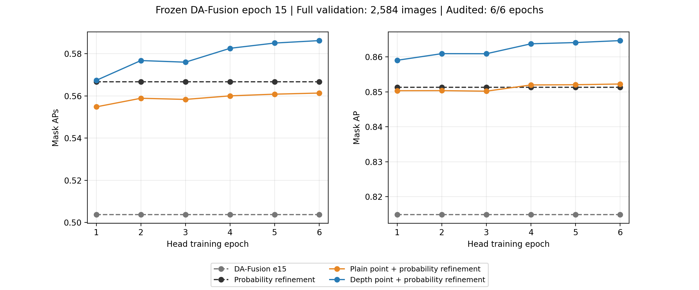

# 第15轮 DA-Fusion 基座上的六轮点头训练：最终结果

## Material Passport

- origin：academic-research-suite / experiment-agent
- mode：run
- verification_status：VALIDATION_ARTIFACTS_AUDITED
- scope：完整整图验证；本轮没有新增测试集或 Kaggle 结果。

## 结果

固定第15轮 DA-Fusion 基座，训练普通点头与深度点头各6轮。每轮覆盖全部14,432张训练图，并对全部2,584张验证图评测六种配置。
最终按验证 APₛ、整体 AP、较早轮次排序，选择第6轮的深度点头＋概率图深度细化：**APₛ 0.586192，AP 0.864680**。
相对同一基座单独使用概率图深度细化，APₛ增加0.019518，AP增加0.013364。

| 第6轮配置 | Mask AP | Mask APₛ |
|---|---:|---:|
| DA-Fusion 第15轮 | 0.814871 | 0.503742 |
| 概率图深度细化 | 0.851316 | 0.566674 |
| 普通点头 | 0.813697 | 0.488593 |
| 普通点头＋概率图深度细化 | 0.852257 | 0.561337 |
| 深度点头 | 0.846843 | 0.547258 |
| 深度点头＋概率图深度细化 | 0.864680 | 0.586192 |

普通点头也使用RGB-D融合特征；深度点头额外接收局部深度差和有效性标记。普通点头组合的小目标指标低于单独概率细化，不能把全部增益归因于通用点细化。

## 六轮变化

| 点头轮次 | 深度点头＋概率细化 AP | APₛ |
|---:|---:|---:|
| 1 | 0.859049 | 0.567358 |
| 2 | 0.860946 | 0.576740 |
| 3 | 0.860922 | 0.575969 |
| 4 | 0.863767 | 0.582540 |
| 5 | 0.864120 | 0.585035 |
| 6 | 0.864680 | 0.586192 |

## 训练与评价

- 双 Swin-Tiny、四尺度 DS/DC 融合、Mask2Former 解码器；基座权重全程冻结。
- 四卡、每卡2张、总batch为8；AdamW，初始学习率0.0003，100步预热后余弦衰减；seed=17。
- 每轮1,804次更新，累计10,824次。两个点头共享采样与匹配，只改变掩码几何，保留类别、分数、数量和顺序。
- 输入与输出掩码均为1024×1024；COCO segm AP在IoU 0.50–0.95十个阈值上平均，small范围为原标注面积[0,1024]，maxDets=[1,10,100]。

## 核验与权重

整次核验通过：四卡训练覆盖、六轮全部预测与评分绑定、基座前后张量一致且无梯度、最终点头重载、优化器与四卡随机状态保存均已检查。训练子进程实际退出码为0。
本轮最终点头：`heads_epoch_06.pt`。
SHA-256：`ec72065e3dd5e869d9ddd217cbddf89b2a3f9d11dd29447e57c38a9e6323ebff`。
基座SHA-256：`ef52456da6bb47e4f38c7cfb26e5eaf88c02895bf674487febd04d24d0dc2059`。

- [完整核验记录](point_e15_audit.json)
- [最终结构化结果与全部36组逐轮指标](point_e15_results.json)
- [正式冻结协议](../../artifacts/protocols/point_e15.json)
- 原始逐图预测与运行文件保留在本机 reports 目录；本页附完整逐轮结果与核验摘要。

这是一次单种子固定预算实验。最佳轮次位于第6轮，不据此宣称已经收敛。切片推理组合和测试/Kaggle成绩沿用各自历史记录，本轮整图验证分数不能替代它们。
